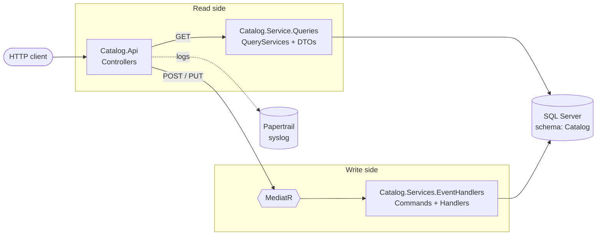

# KODOTI.Commerce: Sample Microservices with .NET Core 3.1

A sample e-commerce backend built as **microservices** on **ASP.NET Core 3.1**. It shows **CQRS** with **MediatR**, **EF Core** on SQL Server, shared building blocks (paging, mapping, collections), and centralized logging to **Papertrail** over syslog.

The first service is **Catalog**, which manages products and their stock.


---

## Contents
- [Architecture](#architecture)
- [Solution structure](#solution-structure)
- [Tech stack](#tech-stack)
- [Getting started](#getting-started)
- [API reference: Catalog](#api-reference-catalog)
- [Logging](#logging)
- [Documentation](#documentation)
- [Roadmap](#roadmap)

---

## Architecture

Each service separates **reads** (queries) from **writes** (commands):

- **Queries:** the controller calls a query service directly. It reads with EF Core, pages the results, and maps them to DTOs.
- **Commands:** the controller publishes a MediatR notification. An event handler applies the change and saves it with EF Core.



Shared libraries such as `Services.Common.*` and `Common.Logging` hold code that other services will reuse as they're added.

---

## Solution structure

```
KODOTI.Commerce.sln
└── src
    ├── Common.Logging/                      # Syslog logger provider (Papertrail)
    └── Services
        ├── Catalog
        │   ├── Catalog.Api/                 # ASP.NET Core Web API (controllers, Startup)
        │   ├── Catalog.Common/              # Shared enums (ProducInStockAction)
        │   ├── Catalog.Domain/              # Entities: Product, ProductInStock
        │   ├── Catalog.Persistence.Database/# DbContext, entity configs, migrations, seed data
        │   ├── Catalog.Service.Queries/     # Read side: query services + DTOs
        │   └── Catalog.Services.EventHandlers/ # Write side: MediatR commands + handlers
        ├── Service.Common.Paging/           # IQueryable.GetPagedAsync(page, take)
        ├── Services.Common.Collection/      # DataCollection<T> (Items, Total, Page, Pages)
        └── Services.Common.Mapping/         # object.MapTo<T>() via System.Text.Json
```

---

## Tech stack

| Concern | Technology |
|---|---|
| Framework | ASP.NET Core 3.1 (`netcoreapp3.1`) |
| Persistence | Entity Framework Core 5.0 + SQL Server |
| CQRS / in-process messaging | MediatR 9 (`INotification` / `INotificationHandler`) |
| Logging | `Microsoft.Extensions.Logging` + custom syslog provider → Papertrail |
| Serialization / mapping | System.Text.Json |

---

## Getting started

### Prerequisites
- [.NET Core 3.1 SDK](https://dotnet.microsoft.com/download/dotnet/3.1)
- SQL Server (LocalDB, Express, Developer, or a Docker container)
- EF Core CLI tools:
  ```bash
  dotnet tool install --global dotnet-ef --version 5.0.3
  ```

### 1. Clone
```bash
git clone https://github.com/blaxzoser/sample-micro-services-dot-net-core-3.git
```
```bash
cd sample-micro-services-dot-net-core-3
```

### 2. Configure
Edit `src/Services/Catalog/Catalog.Api/appsettings.json`, or override the values with user secrets or environment variables:

```json
{
  "ConnectionStrings": {
    "DefaultConnection": "Server=(localdb)\\MSSQLLocalDB;Database=KodotiEcommerce;Trusted_Connection=True;"
  },
  "Papertrail": {
    "host": "logsN.papertrailapp.com",
    "port": 12345
  }
}
```

### 3. Create the database
This applies the migrations and seeds **100 sample products** into the `Catalog` schema.
```bash
dotnet ef database update --project src/Services/Catalog/Catalog.Persistence.Database --startup-project src/Services/Catalog/Catalog.Api
```

### 4. Run
```bash
dotnet run --project src/Services/Catalog/Catalog.Api
```
The API listens on **http://localhost:5000**. `GET /` returns `Running....` as a quick check that it's up.

---

## API reference: Catalog

Base URL: `http://localhost:5000`

### Products: `/products`

| Method | Route | Description | Response |
|---|---|---|---|
| `GET` | `/products?page=1&take=10&ids=1,2,3` | Paged list of products, optionally filtered by ids | `200` `DataCollection<ProductDto>` |
| `GET` | `/products/{id}` | A single product | `200` `ProductDto` |
| `POST` | `/products` | Create a product (command → MediatR) | `200` |

**Create a product**
```http
POST /products
Content-Type: application/json

{
  "name": "Mechanical keyboard",
  "description": "RGB, brown switches",
  "price": 120.50
}
```

**Paged response shape**
```json
{
  "items": [ { "productId": 100, "name": "Product 100", "description": "...", "price": 512 } ],
  "total": 100,
  "page": 1,
  "pages": 10,
  "hasItem": true
}
```

### Stock: `/stocks`

| Method | Route | Description | Response |
|---|---|---|---|
| `GET` | `/stocks?page=1&take=10&products=1,2` | Paged stock records, optionally filtered by product ids | `200` `DataCollection<ProductInStockDto>` |
| `PUT` | `/stocks` | Add or subtract stock for several products in one call | `204` |

**Update stock** (`action`: `0` = Add, `1` = Substract)
```http
PUT /stocks
Content-Type: application/json

{
  "items": [
    { "productId": 1, "stock": 10, "action": 0 },
    { "productId": 2, "stock": 3,  "action": 1 }
  ]
}
```
- **Add** creates the stock record if it doesn't exist yet.
- **Substract** fails if there isn't enough stock. Right now that failure comes back as a `500` (see the [Roadmap](#roadmap)).

---

## Logging

`Common.Logging` adds a custom `ILoggerProvider` that sends log entries over **syslog/UDP** to Papertrail. It's registered in `Startup.Configure`:

```csharp
loggerFactory.AddSyslog(
    Configuration.GetValue<string>("Papertrail:host"),
    Configuration.GetValue<int>("Papertrail:port"));
```

Command handlers log each step, for example `--- ProductInStockUpdateStockCommand started`, so you can follow a request in the Papertrail dashboard.

---

## Documentation

These study guides live in the [`doc/`](doc) folder:

| Document | Description |
|---|---|
| [ASP.NET Controller Cheat Sheet](doc/aspnet-controller-cheatsheet.md) | HTTP verbs, status codes, routing, `ControllerBase` helpers, ProblemDetails, and notes on this codebase |
| [Mock Interview Exercises](doc/aspnet-mock-interview-exercises.md) | 26 timed exercises (15–30 min) for POST, GET, PUT, PATCH, and DELETE, with test cases and solutions |

---

## Roadmap

Planned improvements:

- [ ] Return `404` instead of `500` when a product doesn't exist (`SingleAsync` → `FirstOrDefaultAsync`)
- [ ] Return `201 Created` + `Location` from `POST /products` (switch to `IRequest<int>` + `Send`)
- [ ] Map domain errors (not enough stock) to `409`/`422` through global exception middleware + ProblemDetails
- [ ] Add input validation to commands (DataAnnotations or FluentValidation)
- [ ] Add health checks, Swagger/OpenAPI, and `CancellationToken` support
- [ ] More services: **Customer**, **Order**, plus an **API Gateway** and inter-service messaging
- [ ] Docker / docker-compose for the services and SQL Server
- [ ] Upgrade to a current LTS version of .NET
